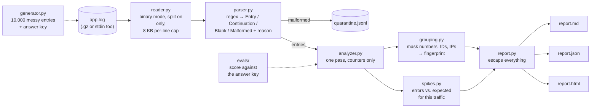

# log-analyzer

[](https://github.com/paulmadojutimi94/log-analyzer/actions/workflows/ci.yml)

**Point it at a messy log file and get back: what broke, how often, when it spiked, and which lines it couldn't read.**

> **Status:** v0.1. Python standard library only: no dependencies to install. 54 tests. Accuracy, latency, cost and attack evals measured; CI re-measures accuracy and attacks on every push.

**Demo (3 min):** [docs/demo/log-analyzer-demo.mp4](docs/demo/log-analyzer-demo.mp4), with a narration script in [docs/DEMO.md](docs/DEMO.md).
**Sample output:** [examples/report.md](examples/report.md) (from the first 40 lines in [examples/app.head.log](examples/app.head.log)).

## The problem

At 2 a.m. the payments page is down and you have a 10,000-line log. Scrolling it is like reading every receipt in a shop to find out why the till is short. What you actually need is the till summary: *which* errors, *how many*, *when they started*, and *which lines were too mangled to read*.

Real logs fight back. Lines get cut off mid-write, two services write at once and glue lines together, one service logs JSON while the rest log text, stack traces spill over many lines, and anything a user typed (a username, a URL) is in there too, including text crafted to fool you.

## What it does

1. **Generates** a realistic 10,000-entry log with planted problems and an answer key, so every claim below is measured, not eyeballed.
2. **Parses** each line with regular expressions, attaches stack traces to their entry, recovers JSON and glued lines, and labels every line it can't read with a reason instead of crashing.
3. **Groups** errors that are the same problem with different details ("timeout after 5012ms" and "timeout after 30000ms").
4. **Detects spikes**: minutes with far more errors than the traffic explains, and which error caused each one.
5. **Reports** in Markdown, JSON and HTML, plus a quarantine file of every malformed line.

```text
$ make demo
Wrote 10,000 log events (10,581 lines) to data/app.log
Analysed 10,581 lines in 0.08s: 9,847 entries, 481 errors in 13 groups, 153 malformed lines, 3 spike(s).
  SPIKE 2026-11-11 12:00-12:01 UTC  peak 12/min (normal 1.28)  NullPointerException in OrderService.process(order_id=<UUID>)
  SPIKE 2026-11-11 13:16-13:16 UTC  peak 11/min (normal 0.79)  Database connection timeout after <NUM>ms (host=db-<NUM>…
  SPIKE 2026-11-11 13:58-14:02 UTC  peak 18/min (normal 1.44)  Database connection timeout after <NUM>ms (host=db-<NUM>…
Top error groups:
     136  Database connection timeout after <NUM>ms (host=db-<NUM>.internal, pool=primary)
      61  NullPointerException in OrderService.process(order_id=<UUID>)
      ...
Malformed: missing_service=39, unknown_level=31, no_timestamp=29, binary_garbage=25, invalid_timestamp=23, missing_level=6
```

Those 3 spikes are exactly the 3 the generator planted, each blamed on the right error. The very first version of this code, run on the same file, reported 192 error groups and 5 spikes, 2 of them false. How that was found and fixed is in the [postmortem](docs/POSTMORTEM.md).

## Architecture



Think of it as a post-room. The **reader** opens the sacks carefully (never tearing open a parcel bigger than it can hold). The **parser** reads each label and sorts parcels into "fine", "part of the previous parcel", "empty" and "damaged, here's why". The **grouper** puts identical complaints in the same pile even when the names on them differ. The **spike detector** notices when one pile suddenly grows faster than the post-room's normal rush explains. The **report** writes the summary, and treats every parcel's writing as possibly hostile.

**One pass, constant memory.** Each entry updates a handful of counters and is then forgotten, so memory grows with the *time span* of the log, not its size (1.4 MB for 200,000 lines).

**Spikes are judged against traffic, not raw counts.** Three times the requests gives three times the errors at the same failure rate: that's busy, not broken. The detector asks "how many errors would a normal minute with *this much traffic* have had?" and only flags minutes far above that. The [design doc](docs/DESIGN.md) shows the two designs that lost.

**Log text is untrusted input.** Anyone who can type into a form can write to your logs. Six defences stop that text from forging log lines, exhausting memory, hanging the regexes or injecting into the reports, and the attack eval switches each one off to prove it's doing real work (results below).

## Try it in one minute

```bash
git clone https://github.com/paulmadojutimi94/log-analyzer && cd log-analyzer
make demo                                   # generate 10,000 entries and analyse them
open reports/report.html                    # or report.md / report.json

# on your own logs (any file, .gz, or "-" for stdin):
PYTHONPATH=src python3 -m log_analyzer analyze /var/log/myapp.log -o reports
kubectl logs deploy/api | PYTHONPATH=src python3 -m log_analyzer analyze - --fail-on-spike
```

Needs Python 3.12+. Nothing to install. `pip install -e .` gives you a `log-analyzer` command if you prefer.

## Eval results

All reproducible with `make eval`, which rewrites this table from `evals/results/`. CI re-measures accuracy, the gold set and attacks on every push and fails if this table drifts from the result.

<!-- results:start -->
| What | Result | How it was measured |
|---|---|---|
| **Parsing:** line classification | **100.0%** of 531,571 lines | 50 held-out generated files (seeds 100-149), every line labelled by the generator |
| **Parsing:** hand-written tricky lines | **39 / 40** | Written and frozen before being run; formats the generator never makes |
| **Malformed lines** caught | precision 100.0%, recall 100.0% | Same 50 files |
| **Recovered** instead of dropped | JSON 1268/1268, glued 1223/1223, bad bytes 1229/1229, CRLF 1259/1259 | Same files |
| **Grouping** (pair F1) | **0.986** (precision 1.000, recall 0.972) | 14.3 groups found per file for 12 real error types |
| **Spikes** found | **150 / 150** (recall 100.0%) | 3 planted per file, 8-20 extra errors/min |
| Spike false alarms | 5 in 50 files (precision 96.8%); 0 from traffic surges | Each file is 6 hours with a planted 3x traffic surge |
| Spike blamed on the right error | **100.0%** | Top group in each caught spike |
| Spike sensitivity | caught 48.8% at +6/min, 89.2% at +8, 100.0% at +10 | 500 synthetic trials per size; ~1.1 errors/min normally |
| False alarms on a quiet log | 0.214 per 24 h | Same synthetic traffic, no spikes |
| **Latency:** analyse 10,000 entries + 3 reports | **p50 75.5 ms, p95 76.3 ms** | 50 runs, warm |
| Latency: whole CLI, cold start | p50 142.0 ms, p95 159.9 ms | 20 runs, includes Python start-up |
| Throughput | 137,361 lines/s | 209,622-line file |
| Peak memory (Python heap) | 0.11 MB at 10k lines, 1.42 MB at 209k | Streaming: grows with the time span, not file size |
| **Cost per task** | **€0.00** | 0 paid API calls; runs locally |
| **Attack success rate**, all defences on | **0 / 32 (0.0%)** | 10 families of attack, each in a sandboxed process |

| Defence switched off | Attacks that then get through |
|---|---|
| Binary line splitting (only `\n` ends a line) | 3 / 3 |
| Recovered glued lines kept out of alerts | 3 / 3 |
| 8 KB line cap with bounded reads | 3 / 5 |
| Cap of 2,000 error groups | 1 / 1 |
| 7-day chart window | 2 / 2 |
| Escaping in HTML, Markdown and terminal output | 16 / 16 |

Measured on Linux x86_64, 2 CPUs, Python 3.13.18.
<!-- results:end -->

How to read it:

- **Two independent accuracy checks.** The generator and the parser were written by the same author, so a perfect score on generated logs is weaker than it looks: both share the same assumptions. The **gold set** is 40 lines written by hand and frozen *before* being run, including formats real services write that the generator never does. Its first run scored 35/40 (timezone offsets, a space instead of `T`, comma milliseconds and tabs all failed), which is exactly why it exists. The one remaining miss is a deliberate trade-off, listed under known failures.
- **Pair F1 for grouping:** take every pair of errors and ask "did we put these two together exactly when they really are the same problem?" Precision 1.000 means we never merged two different problems; recall below 1 means we sometimes split one problem in two.
- **Thresholds were tuned on different files from the ones reported.** Spike settings were chosen on seeds 0-19 and the published numbers come from seeds 100-149, the same way you keep an exam paper away from the practice papers.
- **p50 and p95:** half of the runs were faster than p50, 95 in 100 faster than p95.
- **The ablation table is the point.** 0% attack success with everything on could just mean the attacks were weak. The second table shows each attack getting through once its defence is removed. The line cap stops 3 of its 5 on its own: the other two are slow-regex attacks whose root cause was fixed in the regex itself (see the postmortem), so the cap is now a second layer for them rather than the only one.

## Known failures

- **It only understands one text format** (`timestamp level [service] message`) plus JSON lines. Syslog, Apache access logs and logfmt are labelled malformed, not parsed.
- **A log line quoted inside a message is split off as a "glued" line.** That's the price of recovering genuinely glued lines. Those halves are marked untrusted and never drive groups or spikes, but the entry count is one too high.
- **Variables that are words split groups.** `bucket logs-prod` and `bucket logs-staging` are one problem, but the masks only know numbers, IDs, IPs and e-mails, so they become two groups. This is why grouping recall is 0.97, not 1.
- **Different status codes merge.** `HTTP 503` and `HTTP 404` become `HTTP <NUM>`, which is right for "upstream errors" and wrong if you care which code.
- **No judgement in the first 10 minutes** of a log: there's no history yet to say what normal looks like.
- **Spikes smaller than about +8 errors a minute are often missed** when ~1 error a minute is normal (49% caught at +6, 89% at +8). Lower `k` to catch more at the cost of more false alarms.
- **Out-of-order timestamps are fine for counting, but a line written >30 minutes late lands in the past** and won't be part of the spike it belonged to.
- **Naive timestamps are assumed to be UTC.** A server logging local time without an offset will be shifted.
- **The accuracy numbers come from generated logs.** They prove the analyzer handles the problems we planted, not every problem real logs have. The gold set narrows that gap; it doesn't close it.
- **Attacks were tested on this machine's Python 3.13.** 32 attacks in 10 families are a sample, not a proof nothing else gets through.

## Postmortem

**[Full write-up in docs/POSTMORTEM.md](docs/POSTMORTEM.md).** The headline incident:

- **What happened.** The first accuracy run said grouping recall was 0.68: 12 real error types had become 138 groups per file. Worse, a database-timeout spike was blamed on a different error.
- **How it was found.** Listing the fingerprints per true error type showed `timeout after 21367ms` and `timeout after 26325ms` as separate groups. The number was never masked.
- **Root cause.** The mask was `\b\d+\b`. `\b` is a *word boundary*: the edge between a letter or digit and anything else. In `5012ms` the digits touch the letters `ms`, so there is no boundary after them and the pattern doesn't match. The same hit `1576s`, `8052MB` and `/dev/sda1`.
- **Impact.** Every unit-suffixed number made a new group, so the biggest problem in the log was smeared across dozens of small piles and dropped down the ranking. Spike blame went to whichever unbroken group happened to be largest.
- **Fix and guard.** `\d+(?:\.\d+)?` with no boundaries. Recall went 0.68 → 0.97, groups 138 → 14 per file, spike blame 83% → 100%. Unit tests now pin `5012ms`, `sda1` and friends.

It also covers a regex that hung the tool on 200 hostile lines (12 s → 0.001 s), an attack judge that cried wolf, a crash found by a unit test that the attack eval missed, and the spike detector's redesign.

## Next steps

1. **Run it on a week of real logs** and add every line it gets wrong to the gold set before changing any code.
2. **Learn variable words from the data** (a Drain-style parse tree: a token position that takes many values is a variable), fixing the `logs-prod` / `logs-staging` split.
3. **Plug-in line formats:** syslog, logfmt and Apache access logs, each a named regex with its own gold lines.
4. **Follow mode** (`--follow`, like `tail -f`) with an alert hook, so spikes page someone instead of waiting for a report.
5. **Seasonality:** compare 14:00 today with 14:00 yesterday, not just the last 30 minutes, so the Monday-morning rush isn't a surprise.
6. **Claude summaries, only if people read the report and still ask "so what happened?"** It would get its own eval: summary accuracy against the answer key, cost per report, p95, and prompt-injection success rate (log text is attacker-controlled, so this matters more here than almost anywhere).

## Repo map

| Path | What's there |
|---|---|
| `src/log_analyzer/` | The tool: seven small modules, one job each ([CLAUDE.md](CLAUDE.md) has the map) |
| `tests/` | 54 tests: reader, parser, grouping, spikes, reports, CLI end to end |
| `evals/` | Accuracy, gold set, sensitivity, performance and attack evals, and `run_all.py`, which writes the tables above |
| `evals/results/` | The numbers those evals produced |
| `examples/` | A sample log excerpt and the reports it produces |
| `docs/DESIGN.md` | One-page design doc: decisions and the alternatives rejected |
| `docs/POSTMORTEM.md` | What went wrong and how it was found |
| `docs/CHEATSHEET.md` | Every line of the code explained, for technical interviews |
| `docs/LEARN.md` | File handling, regex and data processing, taught through this code, with exercises |
| `docs/DEMO.md`, `docs/demo/` | The 3-minute video and its narration script |
| `.github/workflows/ci.yml` | On every push: lint, tests, re-measured evals, README check, demo run |
| `CLAUDE.md` | The guide for AI agents working in this repo |

MIT-licensed.
